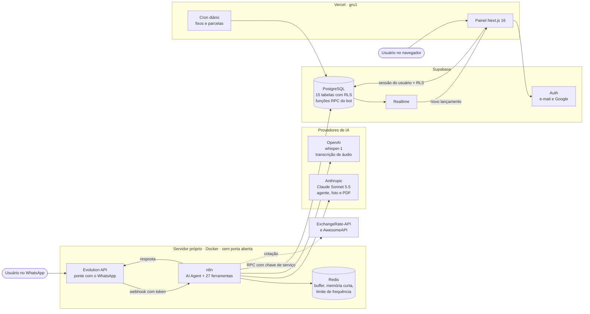
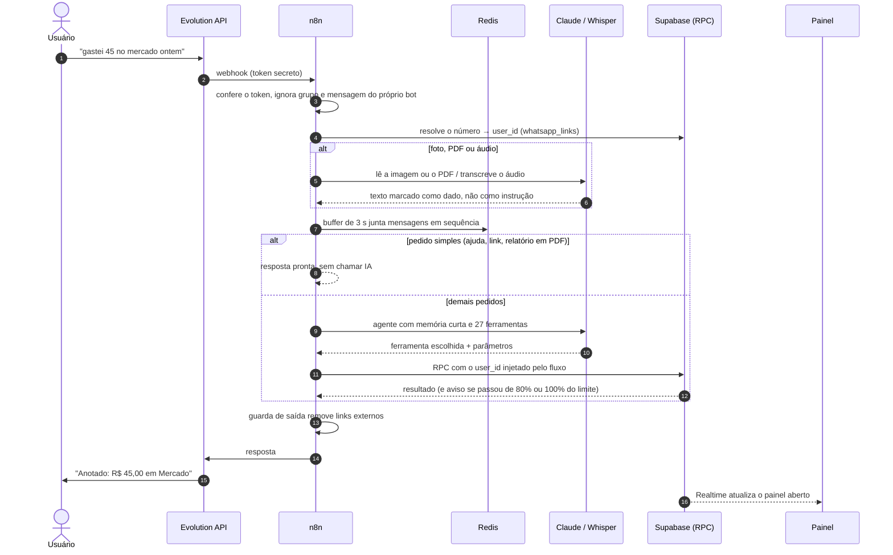
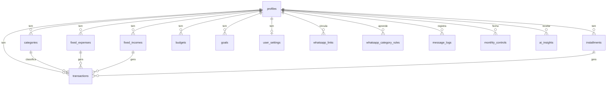
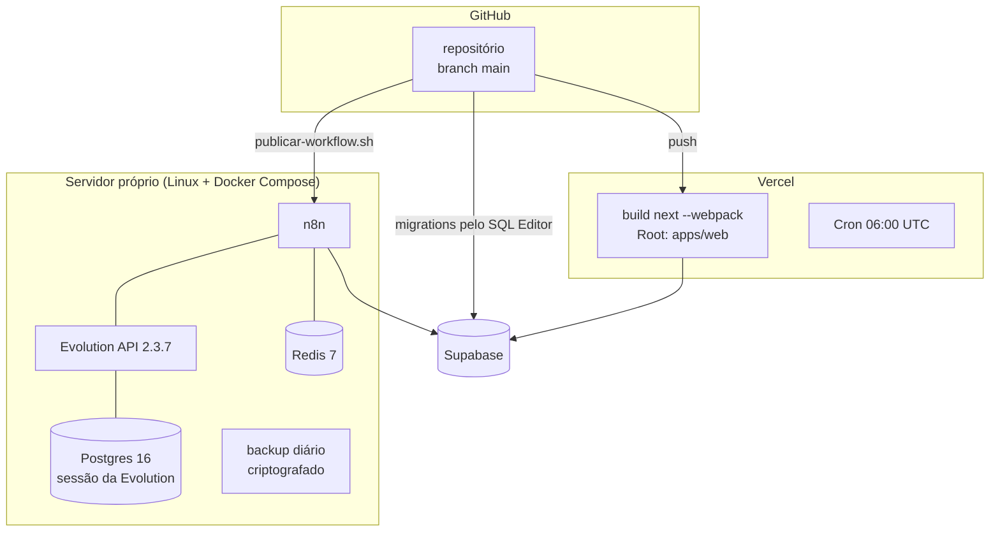

# Moedin-IA

**Assistente financeiro pessoal no WhatsApp, com painel web.** A pessoa manda "gastei 35 no mercado" por texto, áudio, foto de comprovante ou PDF da fatura. Um agente de IA registra e categoriza o lançamento, e um painel web mostra o mês em tempo real.

Trabalho de Conclusão de Curso de Sistemas de Informação (FHO Uniararas, 2026). Em produção em <https://www.moedin-ia.com.br>.


> Resumo para portfólio (problema, solução, desafios e aprendizados): [`docs/portfolio/README.md`](docs/portfolio/README.md).

## Sumário

1. [Visão geral](#1-visão-geral)
2. [Funcionalidades](#2-funcionalidades)
3. [Telas](#3-telas)
4. [Arquitetura](#4-arquitetura)
   - [Componentes](#41-componentes)
   - [Princípios do desenho](#42-princípios-do-desenho)
   - [Caminho de uma mensagem no WhatsApp](#43-caminho-de-uma-mensagem-no-whatsapp)
   - [Bot do WhatsApp (n8n)](#44-bot-do-whatsapp-n8n)
   - [Painel web (Next.js)](#45-painel-web-nextjs)
   - [Banco de dados (Supabase)](#46-banco-de-dados-supabase)
   - [Infraestrutura e deploy](#47-infraestrutura-e-deploy)
   - [Segurança em camadas](#48-segurança-em-camadas)
5. [Tecnologias](#5-tecnologias)
6. [Estrutura do repositório](#6-estrutura-do-repositório)
7. [Rodar localmente](#7-rodar-localmente)
8. [Variáveis de ambiente](#8-variáveis-de-ambiente)
9. [Testes e validação](#9-testes-e-validação)
10. [Publicar](#10-publicar)
11. [Números do projeto](#11-números-do-projeto)
12. [Documentos relacionados](#12-documentos-relacionados)
13. [Versões](#13-versões)
14. [Equipe](#14-equipe)

## 1. Visão geral

| | |
|---|---|
| **Problema** | Controlar gastos exige anotar cada um, e abrir um app para preencher formulário a cada compra faz a pessoa desistir. |
| **Solução** | O registro acontece onde a pessoa já está, no WhatsApp, em linguagem natural e no formato em que a informação chega (texto, áudio, foto, PDF). |
| **Painel** | Web e responsivo: resumo do mês, gráficos, histórico, fixos, parcelamentos, metas e limites. |
| **Ponto central** | O modelo de linguagem **não grava dados**. Ele só escolhe a operação; funções do banco validam e gravam. |
| **Validação** | 15 de 15 casos de uso atendidos com três contas de demonstração (12 meses de dados fictícios) e 12 de 12 casos adversariais aprovados. |

## 2. Funcionalidades

### Pelo WhatsApp

| Grupo | O que dá para fazer |
|---|---|
| **Registrar** | Gasto ou receita em texto livre, vários itens numa mensagem ("uber 20 e almoço 35"), áudio, foto de cupom, moeda estrangeira convertida pela cotação do dia |
| **Importar** | PDF de fatura de cartão, extrato ou planilha: lista os itens, separa parcelados, ignora pagamento da fatura e linha de saldo, pergunta o que importar e não duplica se o arquivo for reenviado |
| **Fixos e parcelas** | "aluguel 1200 todo dia 10", "parcelei 1200 em 6x"; editar, pausar e reativar fixos |
| **Consultar** | Resumo e relatório do mês (texto ou PDF), "quanto gastei com uber esse ano", comparar meses, ver limite, link do painel |
| **Planejar** | Limite do mês, geral e por categoria, com aviso ao lançar; metas de economia; **simular compra** ("posso comprar um fone de 400 em 4x?") sem registrar nada |
| **Corrigir** | "era 5 e não 50", "isso é lazer", excluir, desfazer importação. A categoria corrigida vira regra; se houver mais de um candidato, o assistente pergunta qual |

### Pelo painel web

| Tela | O que faz |
|---|---|
| Dashboard | Saldo do mês, previsão de saldo (desconta fixos e parcelas a vencer), gráficos por categoria, comparação com o mês anterior, análises automáticas |
| Histórico | Lançamentos por mês com totais, filtros, edição, exclusão com desfazer e exportação em CSV |
| Fixos | Gastos e receitas mensais, lançados automaticamente no vencimento |
| Parcelamentos | Total, parcela, progresso e quitação antecipada |
| Categorias, Metas, Limite | Cor e ícone por categoria, metas com progresso, teto do mês |
| WhatsApp / Onboarding | Vínculo do número por código de ativação, botão e QR code |
| Perfil | Dados pessoais, exportar todos os dados e excluir a conta (LGPD) |

Login por e-mail e senha ou Google, recuperação de senha por e-mail, tema escuro e layout para celular.

## 3. Telas

As capturas usam contas de demonstração com dados fictícios.

### WhatsApp


(A) ajuda · (B) dois gastos numa mensagem · (C) áudio · (D) foto de cupom fiscal


(A) correção · (B) importação de fatura em PDF · (C) simulação de compra · (D) relatório do mês

### Painel

| Visão geral | Gráficos e orçamento |
|---|---|
|  |  |

| Histórico | Parcelamentos |
|---|---|
|  |  |

| Metas | Limite de gasto |
|---|---|
|  |  |


## 4. Arquitetura

Três componentes e **um banco só**. O painel e o bot não conversam entre si: os dois leem e gravam no Supabase, e o Realtime avisa o painel quando o bot grava.




### 4.1 Componentes

| Componente | Onde roda | Tecnologia | Responsabilidade |
|---|---|---|---|
| Painel web | Vercel, região São Paulo (`gru1`) | Next.js 16, React 19, TypeScript, Tailwind 4, Recharts | Telas, autenticação, gráficos, exportação e exclusão de conta, rotina diária de recorrências |
| Camada conversacional | Servidor próprio, Docker Compose | n8n (AI Agent), Evolution API 2.3.7, Redis 7 | Receber a mensagem, ler mídia, chamar o modelo, executar a ferramenta, responder |
| Banco de dados | Supabase (gerenciado) | PostgreSQL, Auth, Realtime, pg_cron | Dados, regras de negócio do bot em funções SQL, isolamento por usuário (RLS) |
| Provedores de IA | Externos | Claude Sonnet 5.5 e whisper-1 | Interpretar texto, foto e PDF; transcrever áudio |
| Câmbio | Externos | ExchangeRate-API e AwesomeAPI (reserva) | Cotação diária para gastos em moeda estrangeira |

### 4.2 Princípios do desenho

- **O modelo escolhe, o banco grava.** Cada uma das 27 ferramentas do agente é uma função SQL (RPC) que valida os parâmetros e grava. Divisão de parcelas em centavos, conversão de moeda e datas no fuso de São Paulo nunca passam pelo modelo. Um erro de interpretação fica restrito a um lançamento, que se corrige por mensagem.
- **A identidade não vem do modelo.** O `user_id` sai da tabela `whatsapp_links` e é injetado pelo fluxo em toda chamada. O modelo não tem como escolher de quem são os dados.
- **Um banco só.** Painel e bot compartilham o Supabase. Por isso foi possível trocar o provedor do agente (de um modelo da OpenAI para o Claude, em 20/10/2026) mexendo só nos nós que chamam o provedor, sem alterar banco nem painel.
- **Idempotência por índice único.** Mensagem reenviada, fatura importada duas vezes ou cron rodando de novo não duplicam lançamentos: o banco recusa.
- **Nada aberto para a internet no servidor do bot.** A Evolution e o n8n só fazem conexões de saída; o editor do n8n é acessado por túnel SSH.

### 4.3 Caminho de uma mensagem no WhatsApp



### 4.4 Bot do WhatsApp (n8n)

Workflow principal: [`n8n/workflow/moedin-agente-v2.json`](n8n/workflow/moedin-agente-v2.json), versão **v2.20**, com **99 nós** (109 contando 10 notas do canvas) organizados em 7 setores: recepção, identificação, mídia, buffer, rota e agente, resposta e erros.

**As 27 ferramentas do agente** (cada uma chama uma função do banco):

| Grupo | Ferramentas |
|---|---|
| Lançamentos | `criar_lancamento`, `buscar_lancamentos`, `editar_lancamento`, `excluir_lancamento`, `importar_extrato`, `desfazer_importacao` |
| Fixos e parcelas | `criar_gasto_fixo`, `criar_receita_fixa`, `criar_parcelamento`, `listar_fixos`, `editar_fixo`, `pausar_fixo`, `excluir_fixo` |
| Consultas | `resumo_do_mes`, `relatorio_mensal`, `consultar_gastos`, `comparar_meses`, `cotacao` |
| Categorias | `consultar_categorias`, `criar_categoria`, `corrigir_categoria` |
| Planejamento | `ver_limite_mensal`, `definir_limite_mensal`, `simular_compra`, `criar_meta`, `guardar_na_meta`, `listar_metas` |

Outros dois workflows: `moedin-erros.json` avisa o administrador quando o agente falha, e `moedin-alertas-diarios.json` atualiza as cotações. O bot não envia mensagens por iniciativa própria.

Decisões, histórico versão a versão e limitações: [`n8n/AGENTE-V2.md`](n8n/AGENTE-V2.md). Prompt do agente: [`n8n/SYSTEM-PROMPT-AGENTE-V2.md`](n8n/SYSTEM-PROMPT-AGENTE-V2.md).

### 4.5 Painel web (Next.js)

**Rotas públicas**

| Rota | O que é |
|---|---|
| `/` | Landing com plano único e contador real de usuários |
| `/login`, `/cadastro` | Entrada e cadastro (e-mail e senha ou Google) |
| `/recuperar-senha`, `/atualizar-senha` | Redefinição de senha por link no e-mail |
| `/termos` | Termos de uso e política de privacidade |

**Rotas logadas:** `/dashboard`, `/historico`, `/fixos`, `/parcelamentos`, `/categorias`, `/metas`, `/limite`, `/whatsapp`, `/onboarding`, `/perfil`. As antigas `/gastos-fixos`, `/planejamento-mensal` e `/planos` só redirecionam.

A proteção fica em `src/proxy.ts` (no Next 16 o *middleware* se chama *proxy*) e é reforçada pelo RLS no banco.

**API (`src/app/api`)**

| Rota | Quem chama | O que faz |
|---|---|---|
| `POST /api/categories/ensure` | painel, ao entrar | Cria as categorias padrão que faltarem |
| `GET /api/account/export` | painel | Exporta todos os dados do usuário (LGPD) |
| `POST /api/account/delete` | painel | Exclui a conta e os dados (LGPD) |
| `GET /api/whatsapp/qr` | onboarding | QR code que abre a conversa com o bot |
| `GET /api/cron/recurrences` | Vercel Cron, 06:00 UTC | Gera os lançamentos de fixos e parcelas vencidos |
| `GET /auth/callback` | Supabase Auth | Retorno do login com Google e dos links de e-mail |

Todas exigem sessão, menos o cron (exige `Authorization: Bearer $CRON_SECRET`) e o callback de autenticação. As rotas de API têm limite de requisições com Upstash Redis.

**Regras de dinheiro e datas**

- Valores no formato brasileiro, convertidos em `src/lib/formatters.ts`.
- Parcelas divididas em centavos, com a última fechando o total (`src/lib/money.ts`).
- Datas de negócio sempre em `America/Sao_Paulo`, mesmo com o servidor em UTC (`src/lib/dates.ts`).
- Fixos e parcelas viram lançamento só no vencimento (`src/lib/recurrence-catchup.ts`), ao abrir o painel e pelo cron. É idempotente.
- Excluir é exclusão lógica (`status = 'deleted'`), o que permite desfazer.

### 4.6 Banco de dados (Supabase)




**15 tabelas, todas com RLS.**

| Tabela | Guarda |
|---|---|
| `profiles` | Perfil, criado automaticamente no cadastro |
| `transactions` | Lançamentos, com origem (manual, WhatsApp, fixo, parcela), mês de competência e exclusão lógica |
| `categories` | Categorias do usuário, com cor e ícone |
| `fixed_expenses`, `fixed_incomes` | Gastos e receitas recorrentes |
| `installments` | Compras parceladas |
| `budgets`, `goals` | Limites do mês e metas de economia |
| `user_settings`, `monthly_controls` | Preferências e controle mensal |
| `whatsapp_links` | Vínculo número ↔ conta, feito por código de ativação |
| `whatsapp_category_rules` | Categoria aprendida a partir de correções |
| `message_logs` | Texto das conversas, apagado após 180 dias por job do pg_cron |
| `ai_insights` | Análises automáticas do painel |
| `fx_rates` | Cotações de câmbio (só o servidor acessa) |

**Migrations** em `supabase/migrations/`, de `001` a `038` (mais `003a`, `003b` e `012b`), aplicadas em ordem:

| Faixa | Conteúdo |
|---|---|
| 001–004 | Tabelas base, RLS, criação automática de perfil, consentimento |
| 005–010 | Primeiras funções do WhatsApp, vínculo por código, Realtime |
| 011–021 | Receitas fixas, endurecimento de segurança, retenção de logs, índices únicos contra duplicata |
| 022–033 | Funções do agente: lançamentos, fixos, parcelas, metas, importação, câmbio, categorias, aviso de limite |
| 034–035 | Busca sem acento, reconciliação do repositório com a produção, categorias sem dono |
| 036 | Simular compra contra o limite e o saldo livre |
| 037 | Cotação com mais de 3 dias deixa de valer |
| 038 | Reenviar a mesma planilha ou fatura não duplica os itens |

As funções `whatsapp_*` só executam com a chave de serviço, usada pelo n8n. O painel usa a chave pública e depende do RLS.

### 4.7 Infraestrutura e deploy



- **Painel:** a Vercel publica a `main`. Domínio próprio com HTTPS.
- **Bot:** quatro contêineres (n8n, Evolution API, Postgres da Evolution e Redis), definidos em [`infra/bot/docker-compose.yml`](infra/bot/docker-compose.yml), com backup diário e restauração testada.
- **Banco:** Supabase gerenciado; migrations aplicadas em ordem.

### 4.8 Segurança em camadas

| Camada | Medida |
|---|---|
| Banco | RLS em todas as tabelas; funções do bot fechadas para o público; identidade injetada pelo fluxo |
| Painel | Sessão do Supabase Auth, `proxy.ts`, cabeçalhos de segurança e Content-Security-Policy em `next.config.ts`, limite de requisições |
| Webhook | Token secreto (rejeita sem token), descarta grupos, limite de mensagens por número, mídia acima de 15 MB recusada |
| Agente | Só trata de finanças; texto vindo de arquivo ou áudio entra marcado como dado; exclusões pedidas a partir de arquivo são recusadas; guarda de saída remove links externos |
| Servidor | Nenhuma porta aberta; segredos só em variáveis de ambiente e credenciais do n8n |
| LGPD | Consentimento por versão dos termos; exportar e excluir dados pelo painel; conversas apagadas após 180 dias |

Auditoria de privacidade: [`docs/privacy-lgpd-audit.md`](docs/privacy-lgpd-audit.md). Defesas do agente contra injeção de instruções: seções 20 a 24 de [`n8n/AGENTE-V2.md`](n8n/AGENTE-V2.md).

## 5. Tecnologias

| Camada | Tecnologias |
|---|---|
| Front-end | Next.js 16 (App Router), React 19, TypeScript 5, Tailwind CSS 4, Recharts 3, GSAP (landing), lucide-react, qrcode |
| Dados e autenticação | Supabase: PostgreSQL, Auth (e-mail e Google OAuth), Realtime, RLS, funções PL/pgSQL, pg_cron |
| Automação e IA | n8n (AI Agent com 27 ferramentas HTTP/RPC), Claude Sonnet 5.5 (agente, foto e PDF), whisper-1 (áudio) |
| WhatsApp | Evolution API 2.3.7 |
| Cache e filas | Redis 7 (buffer, memória curta, limite por número) no servidor do bot; Upstash Redis no painel |
| Infraestrutura | Vercel (região `gru1`, Cron), Docker Compose, servidor Linux próprio, domínio `.com.br` |
| Qualidade | Vitest, ESLint, `tsc --noEmit`, bateria adversarial em Python |
| Gestão | Git e GitHub (branch e tag por versão), Kanban no Trello, desenvolvimento incremental |

## 6. Estrutura do repositório

```text
.
├── apps/
│   └── web/                     Painel e landing (Next.js). É o que a Vercel publica.
│       └── src/
│           ├── app/             Rotas: (app) logadas, (auth) login/cadastro, api/, termos
│           ├── components/      Componentes de interface
│           ├── lib/             Dinheiro, datas, recorrência, Supabase, rate limit (+ testes)
│           └── proxy.ts         Proteção das rotas
├── n8n/
│   ├── workflow/                Os três workflows de produção
│   ├── AGENTE-V2.md             Documentação do bot, versão a versão
│   ├── SYSTEM-PROMPT-AGENTE-V2.md
│   └── lib/pdf-relatorio.js     Gerador de PDF usado no workflow (sem biblioteca)
├── supabase/
│   └── migrations/              001 a 038: esquema, RLS, funções do bot, Realtime
├── infra/bot/                   Compose do servidor, publicar, testar, backup e restaurar
├── docs/                        Explicação do código, privacidade, portfólio, prints
├── historico/                   Versões antigas guardadas para consulta (nada ali roda)
├── docker-compose.yml           Ambiente local (n8n, Redis, Evolution, web)
└── .env.example                 Modelo das variáveis de ambiente
```

## 7. Rodar localmente

Pré-requisitos: Node.js 20 ou superior, um projeto Supabase com as migrations aplicadas e, para o bot, Docker.

### Painel

```bash
cd apps/web
npm install
cp ../../.env.example .env.local   # preencha as variáveis (seção 8)
npm run dev
```

Abre em <http://localhost:3000>.

### Bot, sem usar o WhatsApp de verdade

```bash
docker compose -f docker-compose.yml -f infra/bot/docker-compose.teste-local.yml \
  up -d --no-deps redis evolution-stub n8n
bash infra/bot/testar-local.sh "gastei 30 no mercado"
```

Um simulador substitui a Evolution, e as respostas caem em `n8n/files/respostas.log`. O `--no-deps` é obrigatório: sem ele sobe a Evolution real. O banco usado é o configurado no `.env`; apague os lançamentos de teste depois. Passo a passo em [`infra/bot/README.md`](infra/bot/README.md).

## 8. Variáveis de ambiente

O modelo completo, comentado, está em [`.env.example`](.env.example). Arquivos `.env*` não são versionados.

| Variável | Onde | Para quê |
|---|---|---|
| `NEXT_PUBLIC_SUPABASE_URL`, `NEXT_PUBLIC_SUPABASE_PUBLISHABLE_DEFAULT_KEY` | navegador | Conexão com o Supabase (a proteção é o RLS) |
| `NEXT_PUBLIC_APP_URL` | navegador | URL canônica (sitemap, robots, Open Graph) |
| `NEXT_PUBLIC_WHATSAPP_NUMBER` | navegador | Número do bot no botão e no QR |
| `NEXT_PUBLIC_CONTACT_EMAIL` | navegador | Contato de privacidade nos termos |
| `SUPABASE_SERVICE_ROLE_KEY` | só servidor | Cron, exclusão de conta e contador da landing |
| `CRON_SECRET` | só servidor | Protege `/api/cron/recurrences` |
| `UPSTASH_REDIS_REST_URL`, `UPSTASH_REDIS_REST_TOKEN` | só servidor | Limite de requisições nas rotas de API |

No servidor do bot, o n8n lê `SUPABASE_URL`, `SUPABASE_SERVICE_ROLE_KEY`, `EVOLUTION_API_URL`, `EVOLUTION_API_KEY`, `EVOLUTION_INSTANCE`, `WHATSAPP_WEBHOOK_TOKEN`, `MOEDIN_APP_URL` e `N8N_ALERT_WA_ID`. As chaves dos provedores de IA ficam nas credenciais do n8n.

A chave de serviço nunca pode ter prefixo `NEXT_PUBLIC_`.

## 9. Testes e validação

```bash
cd apps/web
npm run lint                # TypeScript + ESLint
npm test                    # Vitest: 32 testes (dinheiro, datas, recorrência, rotas protegidas)
npx next build --webpack    # build de produção
```

- **Bot:** `python3 infra/bot/testes-seguranca.py` roda 12 casos adversariais (pedido fora do escopo, extração das instruções, ordem escondida em arquivo ou áudio, link externo, consulta a outro usuário). Resultado: 12 de 12.
- **Isolamento entre contas:** 12 tentativas de ler, alterar, excluir e inserir dados de outra conta pela API do banco, com a sessão de uma conta de teste. Nenhuma passou.
- **Validação por caso de uso:** os 15 casos de uso foram exercitados em três contas de demonstração com 12 meses de lançamentos fictícios. Em 29 passos, 25 saíram como esperado, três foram afetados por duas falhas (corrigidas na v2.20 do bot e na migration 038, depois retestadas) e um tinha erro no próprio resultado esperado. Os itens de uma planilha (18) e de uma fatura (6) corresponderam ao gabarito.

## 10. Publicar

| Parte | Como |
|---|---|
| Painel | Push na `main` do repositório de deploy; a Vercel faz o build (Root Directory `apps/web`, `next build --webpack`) |
| Banco | Migration nova aplicada no SQL Editor do Supabase, em ordem |
| Bot | `bash infra/bot/publicar-workflow.sh n8n/workflow/moedin-agente-v2.json`. No n8n, salvar não basta: o que roda é a versão publicada |

## 11. Números do projeto

| | |
|---|---|
| Período | março a novembro de 2026 |
| Commits | 93 |
| Versões do sistema | 7 (v0.1 a v3.0); bot na v2.20 |
| Migrations | 38 numeradas (+3 intermediárias) |
| Tabelas | 15, todas com RLS |
| Workflow do bot | 99 nós, 27 ferramentas |
| Código do painel | cerca de 13 mil linhas de TypeScript/TSX |
| Testes automatizados | 32 (Vitest) + 12 casos adversariais |
| Entradas aceitas | texto, áudio, foto, PDF de fatura, extrato ou planilha |

## 12. Documentos relacionados

| Documento | Conteúdo |
|---|---|
| [`docs/portfolio/README.md`](docs/portfolio/README.md) | Resumo do projeto: problema, solução, desafios, aprendizados |
| [`docs/EXPLICACAO_DO_CODIGO.md`](docs/EXPLICACAO_DO_CODIGO.md) | Guia de leitura do código, arquivo por arquivo |
| [`n8n/AGENTE-V2.md`](n8n/AGENTE-V2.md) | Arquitetura e histórico do bot |
| [`infra/bot/README.md`](infra/bot/README.md) | Servidor do bot, publicação, backup e teste local |
| [`docs/REDIS-E-REGEX.md`](docs/REDIS-E-REGEX.md) | Onde o Redis e as expressões regulares aparecem |
| [`docs/privacy-lgpd-audit.md`](docs/privacy-lgpd-audit.md) | Auditoria técnica de privacidade |
| [`docs/REVISAO-FINAL.md`](docs/REVISAO-FINAL.md) | Revisão completa feita antes do fechamento |
| [`DESIGN.md`](DESIGN.md), [`PRODUCT.md`](PRODUCT.md) | Identidade visual e definição do produto |
| [`historico/LEIA.md`](historico/LEIA.md) | O que são os arquivos de versões antigas |

## 13. Versões

Cada marco tem uma branch e uma tag com o mesmo código (`git checkout versao-1.0`).

| Branch | Tag | Data | O que marca |
|---|---|---|---|
| `versao-0.1` | `v0.1` | 31/03/2026 | Protótipo inicial |
| `versao-0.2` | `v0.2` | 10/05/2026 | Sistema refeito em Next.js com Supabase |
| `versao-1.0` | `v1.0` | 10/06/2026 | Versão de junho |
| `versao-1.1` | `v1.1` | 18/08/2026 | Nova identidade visual, ajustes de interface e higiene do banco |
| `versao-2.0` | `v2.0` | 10/09/2026 | Agente de WhatsApp v2 no n8n e vínculo pelo painel |
| `versao-2.1` | `v2.1` | 30/09/2026 | Landing de plano único e agente v2.14 |
| `versao-3.0` | `v3.0` | 13/10/2026 | Revisão final: marca Moedin-IA, correções e limpeza do repositório |

Depois da v3.0, o bot evoluiu na `main`:

| Bot | Data | Mudança |
|---|---|---|
| v2.15 | 15/10/2026 | Simular compra |
| v2.16 | 20/10/2026 | Agente no Claude Sonnet 5.5; câmbio com fonte reserva |
| v2.17 | 26/10/2026 | "Digitando" proporcional e respostas mais naturais |
| v2.18 | 03/11/2026 | Instruções fixas e memória limpa após erro |
| v2.19–v2.20 | 05/11/2026 | Resumo da importação por entradas e saídas; nova tentativa quando o provedor recusa o histórico |

A branch `meta-cloud-api` guarda a migração do bot para a API oficial do WhatsApp, que está pausada.

## 14. Equipe

Trabalho de Conclusão de Curso de Sistemas de Informação da FHO Uniararas, com orientação do Prof. Me. Renato Matthiesen.

- Alefe Cirino
- Gustavo Rodrigues
- Gustavo Timachi
- João Lucas Lima
- Marcio Junior

## Licença

Este repositório não tem licença definida.
